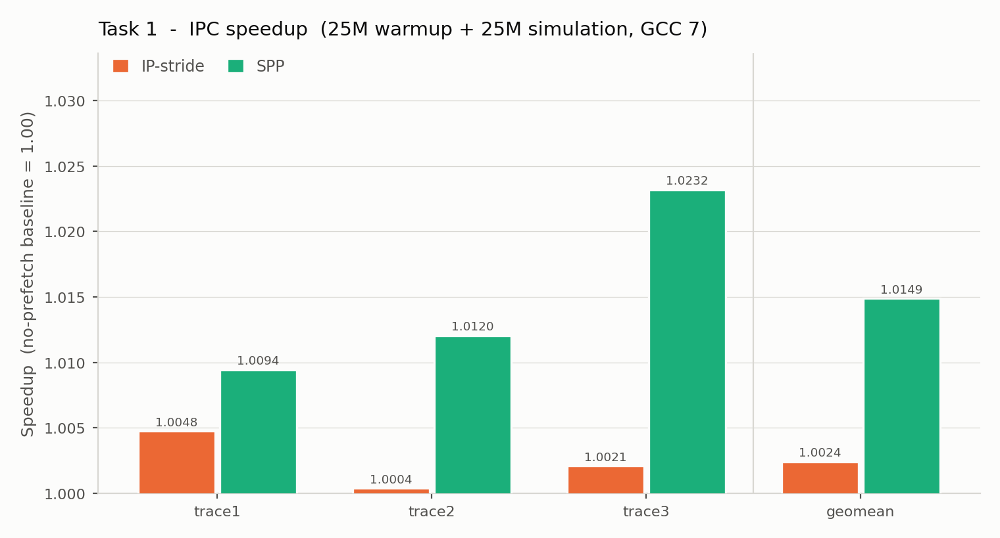
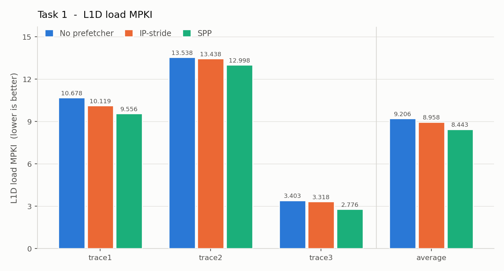
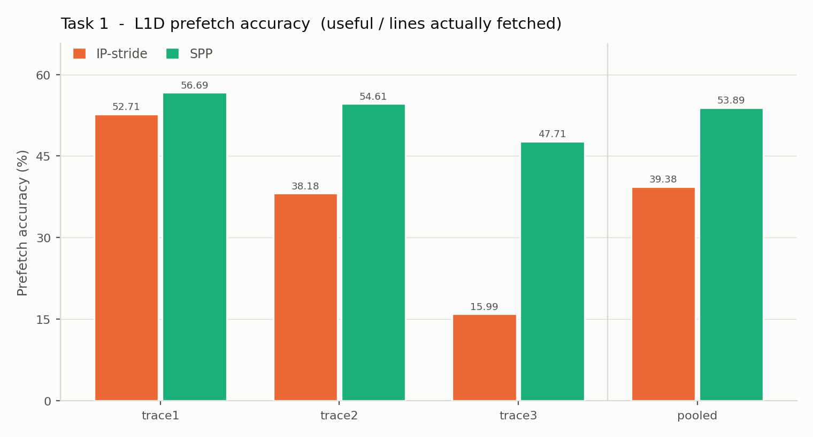
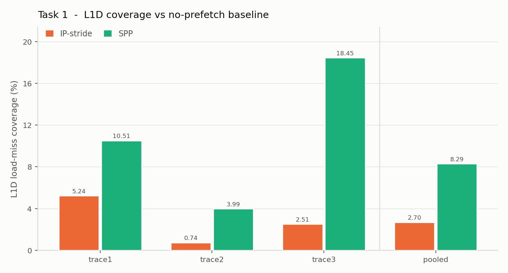

# CS683 PA2 — Task 1: Stride Pattern Prefetching (SPP) at the L1D

**Toolchain:** GCC 7.5.0 at `-O3` (Ubuntu 18.04), as `README.md` requires. Verify with
`readelf -p .comment bin/<binary>`. **Runs:** 25M warmup + 25M simulation, all three
supplied traces. Every number in this document was produced that way.

**Headline:** SPP beats the supplied IP-stride prefetcher on **every metric on every
trace** — geomean speedup **1.0149 vs 1.0024**, pooled accuracy **53.89 % vs 39.38 %**,
pooled L1D load-miss coverage **8.29 % vs 2.70 %** — in **2 947 B** of state, and with
**zero** cross-page prefetch requests.

---

## 0. The brief, and where each part is answered

| PDF deliverable | Here |
|---|---|
| Task 1A — understand `prefetcher/ip_stride.l1d_pref` | §1 |
| Task 1B — implement SPP | §2–§6, code in `prefetcher/spp.l1d_pref` |
| IPC, speedup, L1D load MPKI, accuracy, coverage — tabulated and plotted | §8 |
| Total storage overhead, exact bit-level breakdown per entry | §7 |
| How was the accuracy-throttling threshold decided? | §6.1, measured in §9.3 |
| Why these prefetch degrees for those accuracy ranges? | §6.2, measured in §9.2 |

| Hard constraint the PDF imposes | Where it is satisfied |
|---|---|
| Table tracks accesses per individual IP | §3 |
| Dual classification: uniform **and** repeating non-uniform strides | §4 |
| Uniform first, dynamic fall-back to non-uniform | §4.2 |
| A **signature** of recent strides mapping to the next expected stride | §4.4 |
| Degree **> 1** | §5 |
| Accuracy checker + dynamic degree scaling | §6 |
| **Never cross the OS page boundary** | §3.2 — structural, and verified in §8.5 |
| Lightweight / minimal storage | §7 — 2 947 B, 6 % of the L1D |

---

## 1. Task 1A — the supplied IP-stride prefetcher

`prefetcher/ip_stride.l1d_pref` is 139 lines. Its entire state is:

```c
#define IP_TRACKER_COUNT 24
#define PREFETCH_DEGREE   3
#define MASK_IP        0xFF
class IP_TRACKER { uint64_t ip; uint64_t last_cl_addr; int64_t last_stride; uint32_t lru; };
```

Per access it converts the address to a cache-line address (`addr >> LOG2_BLOCK_SIZE` —
strides are counted in **lines**, because prefetching is line-granular), masks the IP to 8
bits, linearly searches 24 trackers, computes `stride = cl_addr - last_cl_addr`, and
**prefetches only if `stride == last_stride`** — the same stride twice in a row. It then
issues 3 prefetches at `cl_addr + k·stride`, stopping at the first one that leaves the 4 KB
page, and picks `FILL_L1` or `FILL_L2` from MSHR occupancy.

### 1.1 Five concrete weaknesses, and what SPP does about each

Reading it this way turns "make it better" into five specific jobs.

| # | Weakness | Consequence | SPP's answer |
|---|---|---|---|
| 1 | **One stride per IP.** The whole predictor is `last_stride`, and `stride == last_stride` is false on almost every access of a repeating sequence like `(+1,+2,+2,+2,+3)^n`. | It prefetches on 2 of 5 accesses of the PDF's own example, and the addresses it emits (`+2,+4,+6`) are wrong for most of them. | Signature → next-stride table (§4.4) |
| 2 | **`ip & 0xFF` is the whole identity.** Any two load instructions whose PCs agree in the low 8 bits share a tracker. | Silent cross-talk: a loop with loads 256 bytes apart in the binary destroys its own history. | 64 sets × 4 ways with a 16-bit tag → 22 PC bits distinguished (§3.1) |
| 3 | **Fixed degree 3, always.** No notion of whether the prefetches get used. | Pure pollution in phases with no stride structure. | Accuracy-throttled degree 1–4 (§6) |
| 4 | **It trains on its own prefetches.** ChampSim calls `l1d_prefetcher_operate` from the *prefetch queue* too (`src/cache.cc:2465`, `:2649`, `type = PREFETCH`), and `prefetch_line()` copies our IP into the packet. `ip_stride` never checks `type`. | `last_cl_addr` is advanced by addresses the prefetcher invented — a feedback loop on its own output. | `if (type != LOAD) return;` (§3.3) |
| 5 | **Strides folded across page boundaries.** `last_cl_addr` is a full *virtual* line address, so the step into a new page becomes `last_stride`. Because virtual space is linear this is harmless for an IP streaming through *adjacent* pages — the computed stride is the true one. For an IP jumping between *non-adjacent* pages it is an arbitrary number reflecting the allocator, not a pattern. | Not a correctness bug: the page guard rejects every out-of-page candidate (measured: **0** cross-page requests, §8.5). The cost is lost opportunity — the bogus value occupies `last_stride`, so the *next* access cannot match it either. | Strides live in page-offset space (§3.2) |

Weakness 4 is a genuine **correctness** bug; weakness 5 is a **lost-opportunity** bug rather than an incorrectness. Neither is visible
unless you read where ChampSim *calls* the hook rather than only the hook itself. That is
the single most transferable habit in this task.

---

## 2. SPP at a glance

Two tables and one throttle. Nothing else.

```
                    demand LOAD (addr, ip)
                             |
            +----------------v-----------------+
            |  IP TABLE   64 sets x 4 ways     |  per-instruction state:
            |  index = ip[5:0], tag = ip[21:6] |  last offset, last stride,
            +----------------+-----------------+  uniform confidence, signature
                             |
                stride = offset - last_offset
                             |
          +------------------+-------------------+
          |                                      |
   train uniform confidence              train PATTERN TABLE
   (stride == last_stride ?)             pattern_table[signature] = stride
          |                                      |
          +------------------+-------------------+
                             |
            uniform_conf == 3 ?  -- yes -->  offset + k*stride, k = 1..degree
                             |
                             no
                             |
                     signature chain:  sig -> d1 -> sig' -> d2 -> ...
                             |
                   page-confined address generation
                             |
                         prefetch_line()
```

---

## 3. The per-IP table

### 3.1 Geometry: 64 sets × 4 ways = 256 entries

`ip_stride` uses 24 fully-associative entries. Fully associative is unrealistic in hardware
at any useful size — a 256-entry CAM on the L1D access path is not happening — so the real
choice is direct-mapped vs set-associative.

The geometry sweep (§9.1, all three traces) decides it:

| geometry | entries | IP-table bytes | total | mean IP hit rate | avg L1D load MPKI | pooled accuracy |
|---|---|---|---|---|---|---|
| 256 × 1 (direct-mapped) | 256 | 1 728 | 2 883 B | 59.86 % | 8.482 | 53.33 % |
| 128 × 2 | 256 | 1 760 | 2 915 B | 64.32 % | 8.456 | 53.36 % |
| **64 × 4 (chosen)** | **256** | **1 792** | **2 947 B** | **66.00 %** | **8.450** | **53.36 %** |
| 128 × 4 | 512 | 3 584 | 4 739 B | 72.70 % | 8.442 | 52.99 % |
| 64 × 8 | 512 | 3 648 | 4 803 B | 73.51 % | 8.441 | 52.90 % |
| 128 × 8 | 1024 | 7 296 | 8 451 B | 76.97 % | 8.443 | 52.08 % |

**Insight 1 — associativity, not capacity, was the shortfall.** The first three rows hold
storage essentially constant (2 883 → 2 947 B) and only move ways. Hit rate climbs
59.86 → 64.32 → 66.00 %, MPKI falls 8.482 → 8.456 → 8.450, monotonically, for free. An
IP-indexed table is hit by *conflict* misses, not capacity misses, because the hot load PCs
of a loop are few but may collide in the index.

**Insight 2 — past 256 entries the table stops being the constraint, and a bigger one
actively costs accuracy.** Doubling storage lifts the hit rate another ~7 points but moves
MPKI by 0.1 % — and drops accuracy from 53.36 % to 52.90 %. Quadrupling is no better than
doubling and costs 1.3 pp. The mechanism matters: a larger table tracks more *marginal*
instructions, whose weaker patterns clear the confidence bar less often, so the extra
prefetches are worth less per line fetched. **More tracking is not more prediction.**

Since "minimal storage overhead" is an explicit grading criterion, 64 × 4 is where the
curve flattens.

Indexing is `index = ip & 0x3F`, `tag = (ip >> 6) & 0xFFFF` — together 22 bits of PC
against `ip_stride`'s 8. Low PC bits make a good index because x86 instructions are
variable-length, so consecutive load PCs inside a hot loop are already well spread.

### 3.2 Strides live in page-offset space

This is the design choice worth being proudest of, because one representation decision
discharges three separate requirements.

The entry does **not** store a line address. It stores a 12-bit **page tag** (only to
notice the page changed) and a 6-bit **line offset within the page** (`0..63`, since
4096/64 = 64):

```c
uint16_t page   = (addr >> LOG2_PAGE_SIZE) & 0xFFF;
int      offset = (addr >> LOG2_BLOCK_SIZE) & (LINES_PER_PAGE - 1);
int      stride = offset - (int)e.last_offset;
```

and prefetch addresses are built in the same space:

```c
cum += next_stride;
int pf_offset = offset + cum;
if (pf_offset < 0 || pf_offset >= LINES_PER_PAGE) break;   // cannot leave the page
uint64_t pf_addr = (addr & ~((uint64_t)PAGE_SIZE - 1)) | ((uint64_t)pf_offset << LOG2_BLOCK_SIZE);
```

**Insight 3 — three requirements, one choice:**

1. **The page boundary cannot be crossed.** An out-of-page address is never *representable*,
   so this is not a filter that a later edit could remove. ChampSim's own independent
   counter confirms it: **0 cross-page prefetch requests** in every run (§8.5).
2. **Every usable stride is bounded by ±63 lines**, so a **7-bit signed** stride field is
   provably sufficient — no saturation, ever. The storage table in §7 is tight *because of*
   this, not by luck.
3. **`ip_stride`'s weakness 5 disappears.** On a page change the step is not representable,
   so no bogus value can occupy `last_stride`; the entry is re-anchored and the learned
   state survives. To be precise about what this does and does not fix: `ip_stride` is not
   *incorrect* here — its guard blocks every out-of-page candidate — but it carries the
   cross-page value into the next access, where it cannot match, and SPP does not.

**Why the page rule exists at all.** The prefetcher reasons in virtual addresses, but
locality is a property of *physical* frames, and virtual contiguity implies physical
contiguity only **within** a page: pages V and V+1 may map to unrelated frames. Extrapolating
past the boundary therefore predicts an address with no guaranteed physical relationship to
the stream — and it needs a translation the demand stream has not touched. The logs show what
staying in-page buys: `STLB TRANSLATION FROM L1D PREFETCHER` is **226 453 accesses, 226 453
hits, 0 misses** on trace1, because the triggering demand access translated that page
moments earlier. Demand `STLB LOAD TRANSLATION` misses **33 %** of the time over the same
run. Crossing a page would expose a *speculative* request to that miss rate and to a
page-table walk.

On a page change SPP updates `last_page`/`last_offset` but **keeps** `last_stride`,
`uniform_conf` and `signature`. A streaming load crosses a page every 64 lines; resetting
its confidence there would cost three accesses of re-learning per page for nothing, since
the next stride it sees is the same one as before.

### 3.3 Only demand loads train it

```c
if (type != LOAD) return;
```

Three judgements packed into one line.

**Excluding `PREFETCH` is mandatory.** `src/cache.cc` calls `l1d_prefetcher_operate` from
the prefetch-queue path with `type = PREFETCH` and `ip` taken from the packet — and
`prefetch_line()` put *our* IP there. Without the filter, a prefetch SPP issued returns as
a training event on the entry that issued it: it advances `last_offset` to an address the
program never touched, fabricating a stride that is then written into the pattern table as
ground truth. **The predictor would be learning its own output.**

**Excluding `RFO` (stores) is a choice.** The reported metric is L1D *load* MPKI, a store
stream competes for the same 256 entries, and prefetching for stores creates dirty lines
and writeback traffic for guessed data. This is the one design decision still argued rather
than measured; flipping the condition to `type != LOAD && type != RFO` is a one-line
experiment.

**Keeping cache hits is deliberate** — `cache_hit` is ignored. A load's stride sequence is a
property of the *program*, not of what happened to be resident. Training only on misses
would sample the sequence at the points where it missed and compute strides across the
skipped accesses — learning a different, wrong sequence. Predicting on hits is also how a
prefetcher stays *ahead* of a stream it is already succeeding on.

---

## 4. Dual pattern classification

### 4.1 The uniform detector

A 2-bit saturating counter per IP; the uniform path runs only at full confidence:

```c
if (stride == e.last_stride) { if (e.uniform_conf < 3) e.uniform_conf++; }
else                        { e.uniform_conf = 0; }
```

### 4.2 Why the threshold is exactly 3

**Insight 4 — this threshold is *derived*, not tuned.** The PDF's non-uniform example is
`(+1, +2, +2, +2, +3)^n`. Its longest run of identical strides is the three `+2`s, which
produce exactly **two** consecutive `stride == last_stride` events. So:

* threshold 1 or 2 ⇒ the counter reaches it inside the run of `+2`s, and SPP declares the
  assignment's own *non-uniform* example to be a *uniform* stream, emitting `+2, +4, +6`;
* threshold 3 ⇒ unreachable for that sequence; the signature path handles it throughout.

`scripts/verify_design.py` proves it mechanically, with no simulation:

```
threshold T=1: declared UNIFORM on   80 of 200 accesses  -> WRONG
threshold T=2: declared UNIFORM on   40 of 200 accesses  -> WRONG
threshold T=3: declared UNIFORM on    0 of 200 accesses  -> correct
```

3 is therefore the **smallest** threshold that provably never misclassifies the pattern the
assignment asks us to capture — and smallest matters, because every extra count is an extra
access during which a genuinely uniform stream is not being prefetched by the cheap path. A
2-bit counter saturating at 3 is exactly the right width.

§9.4 measures what this costs: a threshold of 2 would score 53.45 % pooled accuracy against
3's 53.36 %, a 0.09 pp difference. **Correctness is free here** — honouring the spec costs
nothing measurable.

### 4.3 Hard reset, not decrement

On a mismatching stride `uniform_conf` is set to **0**, not decremented. A decrement from 3
would need three mismatching accesses before the fall-back engages, and during those three
SPP would keep extrapolating `addr + k·stride` from a stride the program has abandoned —
exactly the pollution the throttling requirement exists to prevent. A reset falls back on
the *same access* that detects the break, which is what "dynamically transition or fall
back" asks for.

The asymmetry is deliberate, because the two errors are not symmetric: being slow to
*leave* uniform mode emits wrong addresses; being slow to *enter* it merely routes through
the signature path, which for a constant stride predicts the same thing anyway.

### 4.4 Both predictors are trained on every access

```c
spp_train_pattern(e.signature, stride);          /* always */
e.signature = spp_update_signature(e.signature, stride);
```

**Insight 5 — train always, predict selectively.** If the signature path were trained only
while in non-uniform mode, every uniform → non-uniform transition would start from a *cold*
table: the signature would index a zero-confidence entry, the chain would refuse to
predict, and SPP would emit nothing for hundreds of accesses after each phase change — the
opposite of adapting quickly to a region.

Training always costs nothing and has a bonus: during a long constant-stride phase the
table fills with entries of the form `sig(d,d,d,d) → d`, so **the non-uniform path degrades
gracefully into the uniform prediction.** The two predictors agree where they overlap,
which makes the hand-off in either direction seamless rather than a cliff — and is why the
uniform path is a cheap fast path rather than a functional necessity.

### 4.5 The signature

```c
uint16_t spp_update_signature(uint16_t sig, int stride)
{
    return ((sig << 3) ^ (stride & 0x7F)) & 0x3FF;   /* 10-bit signature */
}
```

A 10-bit rolling fold keeping roughly the **last four strides**. The pattern table is a
direct-mapped array of 1024 entries of `{7-bit signed stride, 2-bit confidence}`.

**Why a signature at all** — the PDF requires one: *"the design must maintain a signature
that represents the sequence of recently observed strides. This signature should map to the
next expected stride."* The alternatives are excluded by that wording and by cost:

* **Store the last k strides per IP and search for the period** — the obvious first idea.
  Costs `k × 7` bits per IP (28 at k=4, vs 10 for a signature) *plus* a comparator tree,
  and only predicts periods visible inside its own window.
* **A table per IP** — storage explodes and nothing is shared between instructions walking
  the same structure.
* **A global table indexed by signature** (chosen) learns a *pattern* once and lets every IP
  exhibiting it benefit.

**Why this fold.** Shift-3-and-XOR keeps information from all 7 stride bits, so large and
negative strides still differentiate. A clean 3-bits-per-stride concatenation would alias
`-1` onto `+7`, breaking every descending pattern.

**Insight 6 — the confidence counter is also the collision handler, which is why the table
needs no tag.**

```c
if      (p.conf > 0 && p.stride == stride) { if (p.conf < 3) p.conf++; }  /* confirmed  */
else if (p.conf == 0)                      { p.stride = stride; p.conf = 1; }  /* adopt */
else                                       { p.conf--; }                 /* discredit  */
```

The stored stride is replaced **only once the entry is fully discredited**. A single odd
access cannot wipe out a pattern learned over thousands of iterations, while a genuine phase
change still flips the entry after two mispredictions. A colliding signature therefore does
not corrupt a value — it drives `conf` down, and `conf < 2` means "refuse to predict".
Paying 16 bits of tag per entry to prevent what a 2-bit counter already handles would nearly
triple the table's cost. **The tagless design is a consequence of the confidence policy, not
a shortcut.**

**Verification that 10 bits suffice.** The risk is that two phases of a pattern share a
signature, so one can never be predicted. The PDF's example has period **5** while the
signature holds ~4 strides, so this needed checking:

```
distinct signatures used: 5 (expect 5)
  sig 0x093 -> [1]   sig 0x099 -> [2]   sig 0x0ca -> [2]
  sig 0x252 -> [2]   sig 0x292 -> [3]
verdict: signature fully disambiguates the pattern
```

All five phases get distinct signatures mapping to a single outcome. (A period-*p* sequence
is disambiguated by a window of *p−1* as long as no two phases share their predecessor
history.) The script also verifies `[1,2,3]`, `[4,-1]`, `[1,1,2]`, `[8,8,8,1]`, `[2]` and
`[1,2,4,8,16]` — including the negative-stride case, and the pure-uniform case `[2]`, which
confirms §4.4's claim that the signature path subsumes the uniform one.

---

## 5. Degree > 1: the lookahead chain

**Insight 7 — a non-uniform pattern cannot be extrapolated by multiplication.** For a
uniform stride, `addr + 2·stride` is meaningful. For `(+1,+2,+2,+2,+3)` it is simply wrong,
because the second stride is a different number. To go two deep you must know that after
`+1` comes `+2`, and the only way to get that from a signature → stride map is to **replay
the predictor on its own output**:

```
sig   --lookup--> d1 ;  prefetch offset + d1
sig' = update(sig, d1) --lookup--> d2 ;  prefetch offset + d1 + d2
...
```

Both paths are therefore written as **one loop**, differing only in where `next_stride`
comes from:

```c
for (int i = 0; i < spp_degree; i++) {
    int next_stride;
    if (uniform) {
        next_stride = e.last_stride;                     /* same step every time */
    } else {
        PATTERN_ENTRY &p = pattern_table[sig];
        if (p.conf < PATTERN_CONF_PREDICT) break;         /* not confident enough */
        next_stride = p.stride;
        if (next_stride == 0) break;                      /* would not advance    */
        sig = spp_update_signature(sig, next_stride);     /* speculative step     */
    }
    cum += next_stride;
    int pf_offset = offset + cum;
    if (pf_offset < 0 || pf_offset >= LINES_PER_PAGE) break;    /* page confinement */
    ...
    prefetch_line(...);
}
```

Writing it as one loop is not cosmetic: it is what guarantees both paths obey the same page
confinement, the same degree and the same accounting. Two loops is how one of them ends up
violating a constraint after a later edit.

Each guard earns its place:

* `p.conf < 2` → **break, not continue.** Every later address is built on top of this stride
  (`cum += next_stride`), so once a link is untrustworthy the whole remainder is garbage.
* `next_stride == 0` → break; a zero stride would re-emit the same address `degree` times.
* page bounds → break (§3.2).

**Insight 8 — the effective degree is self-limiting even before throttling.** `spp_degree`
is only an upper bound; the chain stops early whenever confidence runs out or the page ends.
The counter `chains cut by conf` shows this firing **213 K–438 K times per run** — those are
occasions where SPP had degree budget left and *chose not to use it*. SPP is aggressive
exactly where it has evidence and quiet where it does not, which is part of the throttling
behaviour arriving for free from the structure.

**Fill level.** `FILL_L1` while the L1D MSHR is less than half occupied, `FILL_L2`
otherwise — identical to `ip_stride`, so the comparison isolates the *prediction* change
rather than confounding it with a placement change. The rule is sound on its own terms: when
MSHRs are half full, the demand misses queued there matter more than our guesses.

---

## 6. Accuracy-based throttling

### 6.1 The usefulness metric

ChampSim prints two things that both look like accuracy (`src/main.cc:248`, `:253`):

```
L1D PREFETCH  REQUESTED: 1075443  ISSUED: 1075443  USEFUL: 39437  USELESS: 23256
L1D USEFUL LOAD PREFETCHES: 39437  PREFETCH ISSUED TO LOWER LEVEL: 69907  ACCURACY: 56.41
```

giving two candidate ratios: `USEFUL/ISSUED` = **3.7 %**, and
`USEFUL/pf_lower_level` = **56.4 %** — the field ChampSim actually labels `ACCURACY`.

**Insight 9 — the denominator must be lines actually fetched, not requests issued.**
`pf_lower_level` is incremented at `src/cache.cc:2604` — *"Increment for new prefetch
miss"* — only when a prefetch **misses and allocates an MSHR entry**, i.e. only when it
genuinely pulls a line in. The gap between 1 075 443 and 69 907 is prefetches that **hit in
the L1D and were dropped**: the data was already there.

> Accuracy-based throttling exists to prevent **cache pollution**. A prefetch dropped
> because the line is already resident evicts nothing, consumes no bandwidth and pollutes
> nothing. Putting it in the denominator of an anti-pollution metric is a category error —
> it dilutes the signal with events that cannot cause the harm the metric detects.

Using `USEFUL/ISSUED` would read ~2–5 % for *any* prefetcher and pin the degree at the floor
forever, i.e. switch the throttle off while appearing to implement it. (§8.3 reports both
columns so this is visible in the data.)

So the internal metric is

```
                   Δ(pf_useful) + Δ(late_prefetch)
    usefulness U = ---------------------------------
                        Δ(pf_lower_level)
```

**Insight 10 — `late_prefetch` belongs in the numerator.** It counts prefetches a demand
access caught while still in flight (`src/cache.cc:2250`). The *address was correct* —
nothing was polluted; the prefetch was merely issued too late to hide the full latency.
Penalising it would be actively backwards, because the throttle's response to low accuracy
is to **reduce** the degree, which shortens the lookahead and makes late prefetches
*later*. Counting address-correctness rather than timeliness keeps the control loop
pointing the right way.

**A windowed ratio, not a cumulative one.** The task asks the prefetcher to adapt to regions
of a trace with different behaviour. A cumulative ratio over 25M instructions is dominated
by its own history and effectively frozen after the first million — it cannot express "this
phase is going badly".

**Window = 256 lines pulled**, chosen by measurement (§9.3): it beats 512 and 1024 on both
MPKI and accuracy on all three traces individually. At 256 the throttle re-evaluates
322–542 times per run, roughly one update per 50–80K instructions. The trend across
{256, 512, 1024} is monotone in favour of smaller, so the optimum may lie below 256; 128 is
untested, and 256 is the best of the three measured rather than a proven minimum.

**One implementation detail that would otherwise silently break everything.** Both snapshots
are read as **signed** differences and clamped at zero, because ChampSim zeroes `pf_useful`
and `pf_lower_level` at the ROI boundary (`src/main.cc:442`) while our snapshots still hold
pre-reset values. Without the clamp the unsigned subtraction wraps to ~2⁶⁴ and the degree
jams at maximum for the entire measured region.

### 6.2 Thresholds and degrees

```c
if      (acc >= 75) spp_degree = 4;
else if (acc >= 50) spp_degree = 3;
else if (acc >= 25) spp_degree = 2;
else                spp_degree = 1;
```

**Quartile thresholds (25/50/75).** With a four-way decision on a 0–100 % metric, equal
quarters is the information-theoretically neutral split; any other split asserts prior
knowledge about where accuracy concentrates across three unseen traces. Equal quarters also
keeps each band 25 points wide, which matters because a windowed metric is noisy — narrow
bands would make the degree flap on measurement noise rather than real phase change.

**Why 4 at the top.** Measured across all three traces (§9.2):

| cap | avg L1D load MPKI | pooled accuracy | pooled coverage |
|---|---|---|---|
| 1–3 | 8.463 | 53.18 % | 8.08 % |
| **1–4 (chosen)** | **8.450** | **53.36 %** | **8.22 %** |
| 1–6 | 8.428 | 52.49 % | 8.46 % |
| 1–8 | 8.407 | 49.92 % | 8.68 % |

**Insight 11 — depth buys coverage *with* accuracy, not for free.** Deeper really is better
on MPKI and coverage; the cost is accuracy. Going to 1–8 buys 0.46 pp of coverage and
surrenders **3.4 pp of accuracy** while pulling 18 % more lines into a 48 KB L1D. Since
accuracy is an explicitly graded metric and the PDF asks the throttle to *prevent cache
pollution*, trading accuracy for coverage is trading the wrong way. 1–4 is the cap at which
accuracy is still at its maximum. This is also consistent with compounded chain confidence:
at ~0.8 per step, four steps is ≈ 0.41 — already a coin flip.

**Why the floor is 1 and not 0.** **Insight 12 — a control loop must never be able to switch
off its own sensor.** Degree 0 is an absorbing state: with no prefetches issued,
`pf_lower_level` stops advancing, the window never closes, no new accuracy is ever measured,
and the prefetcher can **never recover** — one bad phase would disable it permanently.
Degree 1 keeps a trickle flowing, which keeps the measurement alive. (It also keeps us
compliant with "must support a degree of more than 1": the design degree is 4, and 1 is
reached only below 25 % accuracy, i.e. when prefetching is doing net harm.)

### 6.3 Does throttling earn its keep?

The question the whole requirement turns on, answered by running the identical design with
the throttle disabled at a fixed degree 4:

| trace | prefetch requests issued | lines actually fetched | accuracy |
|---|---|---|---|
| trace1 | 1 075 443 → 1 373 560 (**+27.7 %**) | 69 907 → 80 095 (**+14.6 %**) | 56.41 → 52.52 % (**−3.9 pp**) |
| trace2 | 718 996 → 1 002 668 (**+39.5 %**) | 30 314 → 38 991 (**+28.6 %**) | 54.34 → 45.42 % (**−8.9 pp**) |
| trace3 | 1 133 921 → 1 533 965 (**+35.3 %**) | 35 460 → 47 628 (**+34.3 %**) | 46.52 → 39.05 % (**−7.5 pp**) |

For all that extra traffic, average MPKI moves 8.450 → 8.428 and geomean speedup does not
move at all.

**Insight 13 — throttling removes 15–34 % of the lines the prefetcher drags into a 48 KB
L1D and gains 3.9–8.9 pp of accuracy, for no measurable IPC cost.** The aggressive
configuration was spending its extra bandwidth on lines that were never used. Note also the
asymmetry: the throttle helps most on trace2 and trace3, exactly the traces where SPP's
accuracy is lowest and pollution would hurt most. **A fixed degree cannot do that.**

### 6.4 One measurement caveat

Because of the `FILL_L2` path, a prefetch issued when the MSHRs are busy never fills the
L1D, so it can never set an L1D prefetch bit and can never be credited as `pf_useful` —
while it *is* counted in the denominator if it allocated an L1D MSHR entry. Measured
accuracy is therefore slightly **pessimistic**, biasing the throttle toward being
conservative. The bias is in the safe direction, and naming it is better than pretending the
metric is exact.

---

## 7. Storage — exact bit-level breakdown

### 7.1 IP table — 64 sets × 4 ways = 256 entries

| Field | Bits | Why exactly this width |
|---|---|---|
| `tag` | 16 | PC bits [21:6]; with the 6 index bits, 22 PC bits are distinguished |
| `valid` | 1 | |
| `last_page` | 12 | page **tag** only — its sole job is to detect a page change |
| `last_offset` | 6 | a 4 KB page holds 4096/64 = 64 lines, so 6 bits is exact |
| `last_stride` | 7 | signed; strides are confined to ±63 lines by §3.2, so 7 bits cannot overflow |
| `uniform_conf` | 2 | saturates at 3, the threshold derived in §4.2 |
| `signature` | 10 | the 10-bit signature of §4.5 |
| `lru` | 2 | 4 ways ⇒ 2 bits |
| **per entry** | **56** | |

**256 × 56 = 14 336 bits = 1 792 B**

### 7.2 Pattern table — 1024 entries, direct-mapped, tagless

| Field | Bits | Why |
|---|---|---|
| `stride` | 7 | signed, ±63 lines (§3.2) |
| `conf` | 2 | 2-bit saturating counter (§4.5) |
| *(tag)* | **0** | deliberately absent — collisions are absorbed by `conf` (§4.5) |
| **per entry** | **9** | |

**1024 × 9 = 9 216 bits = 1 152 B**

### 7.3 Throttling unit

| Field | Bits | Why |
|---|---|---|
| `spp_degree` | 3 | holds 1..4 |
| window counter: lines pulled | 9 | window is 256, plus the ≤32 prefetches in flight |
| window counter: useful count | 9 | bounded by the above |
| **total** | **21** | ≈ 3 B |

### 7.4 Total

| Structure | Bytes |
|---|---|
| IP table | 1 792 |
| Pattern table | 1 152 |
| Throttling unit | 3 |
| **SPP total** | **2 947 B ≈ 2.88 KB** |

The L1D here is 64 sets × 12 ways × 64 B = **48 KB**, so SPP adds **≈ 6.0 %** — comfortably
lightweight, and most of it (1 792 B) is the table whose size §9.1 justifies by measurement.

**One piece of state declared rather than hidden:** the accuracy checker's "useful" event is
a demand hit on a prefetched line, which in ChampSim is `BLOCK::prefetch` — **1 bit per L1D
line**, 768 lines = **96 B**. Real L1Ds already carry this bit and the baseline cache
maintains it, so nothing was added; but an honest accounting should say the throttle
consumes it. Counting it would make the total 3 043 B (6.2 % of the L1D). The alternative —
a separate prefetch-address filter of ~1 KB — would measure *exactly the same event* at ten
times the cost.

---

## 8. Results

GCC 7.5.0 `-O3`, 25M warmup + 25M simulation, all three traces. Raw logs in
`results/task1/`; CSV in `results/task1/task1.csv`; these tables are regenerated verbatim
by `scripts/parse_results.py` into `results/task1/task1_tables.md`.

```bash
./scripts/run_task1.sh ../traces 3
python3 scripts/parse_results.py results/task1 results/task1/task1.csv
python3 scripts/plot_task1.py  results/task1/task1.csv results/task1
```

Definitions, all from the ROI half of each log (ChampSim resets every cache and prefetch
counter at the ROI boundary, `src/main.cc:442`):

* **IPC** — `CPU 0 cumulative IPC` under *Region of Interest Statistics*
* **Speedup** — IPC(config) / IPC(baseline, no prefetcher)
* **L1D load MPKI** — the `MPKI` field of the `L1D LOAD` line
* **Prefetch accuracy** — the field ChampSim labels `ACCURACY` (= `pf_useful / pf_lower_level`), §6.1
* **L1D coverage** — `(misses_baseline − misses_config) / misses_baseline`, the PDF's formula

`scripts/parse_results.py` refuses to emit results that fail its own checks (25M+25M
actually simulated, zero cross-page prefetches, baseline issuing no prefetches) and reported
**all checks passed**.

### 8.1 IPC and speedup

| Trace | IPC baseline | IPC ip_stride | IPC SPP | Speedup ip_stride | Speedup SPP |
|---|---|---|---|---|---|
| trace1 | 0.2323 | 0.2335 | 0.2345 | 1.0048 | 1.0094 |
| trace2 | 0.2512 | 0.2513 | 0.2542 | 1.0004 | 1.0120 |
| trace3 | 0.3821 | 0.3829 | 0.3909 | 1.0021 | 1.0232 |
| **geomean** | — | — | — | **1.0024** | **1.0149** |



### 8.2 L1D load MPKI

| Trace | baseline | ip_stride | SPP | SPP reduction vs baseline |
|---|---|---|---|---|
| trace1 | 10.678 | 10.119 | 9.556 | 10.51 % |
| trace2 | 13.538 | 13.438 | 12.998 | 3.99 % |
| trace3 | 3.403 | 3.318 | 2.776 | 18.45 % |
| **average** | **9.206** | **8.958** | **8.443** | |



### 8.3 Prefetch accuracy and L1D coverage

Accuracy is ChampSim's `ACCURACY` field; `useful / issued` is bracketed.

| Trace | acc ip_stride | acc SPP | coverage ip_stride | coverage SPP |
|---|---|---|---|---|
| trace1 | 52.71 % (5.46 %) | 56.69 % (3.68 %) | 5.24 % | 10.51 % |
| trace2 | 38.18 % (2.89 %) | 54.61 % (2.27 %) | 0.74 % | 3.99 % |
| trace3 | 15.99 % (1.36 %) | 47.71 % (1.51 %) | 2.51 % | 18.45 % |
| *equal-weight mean* | 35.63 % | 53.01 % | 2.83 % | 10.98 % |
| **pooled (sum/sum)** | **39.38 %** | **53.89 %** | **2.70 %** | **8.29 %** |

The bracketed `useful / issued` column sits between 1.4 % and 5.5 % for *both* prefetchers
while the real accuracy is 16–57 % — the empirical proof of §6.1's argument about which
denominator to throttle on.





### 8.4 SPP internal behaviour

From `l1d_prefetcher_final_stats()`. These are our own counters, which ChampSim does not
reset at the ROI boundary, so unlike every other table here they describe the **whole run
(25M warmup + 25M ROI)**.

| Trace | uniform path | non-uniform path | mean windowed usefulness | windows | degree histogram | IP-table hit rate | pattern entries conf≥2 | chains cut by conf |
|---|---|---|---|---|---|---|---|---|
| trace1 | 32.36 % | 67.64 % | 64.59 % | 542 | d1=3 d2=105 d3=261 d4=173 | 67.86 % | 320 / 1024 | 438 330 |
| trace2 | 18.18 % | 81.82 % | 67.52 % | 322 | d1=15 d2=60 d3=108 d4=139 | 43.43 % | 267 / 1024 | 339 561 |
| trace3 | 46.85 % | 53.15 % | 61.44 % | 372 | d1=41 d2=65 d3=133 d4=133 | 86.69 % | 337 / 1024 | 213 169 |

**This is the table that proves the design is actually doing what it claims.** Both
classification paths are materially active on every trace (18–47 % uniform), every degree is
visited on every trace, and the degree distribution differs per workload — a fixed-degree
prefetcher has no such adaptation. Mean windowed usefulness (61–68 %) sits consistently
*above* the reported ROI accuracy (48–57 %) exactly as §6.1 predicts, because the internal
metric counts late prefetches as useful while ChampSim's `ACCURACY` does not. The two
disagreeing in the predicted direction by the predicted amount is good evidence both are
measuring what we think.

### 8.5 Page confinement — verified by ChampSim, not by us

`prefetch_line()` counts cross-page prefetch requests itself (`src/cache.cc:3652`),
independently of any counter of ours:

| Trace | config | cross-page prefetch requests | same-page prefetch requests |
|---|---|---|---|
| trace1 | IP-stride | **0** | 547 035 |
| trace1 | SPP | **0** | 1 460 645 |
| trace2 | IP-stride | **0** | 149 721 |
| trace2 | SPP | **0** | 970 138 |
| trace3 | IP-stride | **0** | 363 276 |
| trace3 | SPP | **0** | 1 250 130 |

### 8.6 Run provenance

| Trace | config | warmup instrs | simulated instrs | simulated cycles |
|---|---|---|---|---|
| trace1 | No prefetcher | 25 000 004 | 25 000 000 | 107 598 652 |
| trace1 | IP-stride | 25 000 004 | 25 000 000 | 107 088 310 |
| trace1 | SPP | 25 000 004 | 25 000 000 | 106 591 670 |
| trace2 | No prefetcher | 25 000 002 | 25 000 001 | 99 538 958 |
| trace2 | IP-stride | 25 000 002 | 25 000 001 | 99 498 688 |
| trace2 | SPP | 25 000 002 | 25 000 001 | 98 353 834 |
| trace3 | No prefetcher | 25 000 002 | 25 000 001 | 65 433 974 |
| trace3 | IP-stride | 25 000 002 | 25 000 001 | 65 297 638 |
| trace3 | SPP | 25 000 002 | 25 000 001 | 63 951 239 |

### 8.7 Which average for which metric

Three metrics need three different aggregates, and using the wrong one is a classic way to
mislead with benchmark data.

| Metric | Aggregate | Why |
|---|---|---|
| **Speedup** | **geometric mean** | Speedup is a *ratio*. The arithmetic mean of ratios depends on which machine you normalised to — renormalise and the ranking can flip. The geometric mean is invariant, because `GM(a/b) = GM(a)/GM(b)`. (Fleming & Wallace, *How not to lie with statistics*, CACM 1986.) |
| **L1D load MPKI** | arithmetic mean | Already normalised per 1000 instructions, and every trace ran *exactly* 25M, so equal weights are correct. Verified: pooling raw misses gives 9.206 / 8.958 / 8.443 — identical to three decimals. |
| **Accuracy, coverage** | **pooled** (Σ num / Σ den) | These are themselves ratios of event counts; averaging per-trace percentages gives a trace with few misses the same vote as one with many. trace3 is exactly that case — lowest miss count, highest coverage — so the equal-weight mean flatters SPP (10.98 %) relative to the pooled truth (8.29 %). |

**Insight 14 — the conclusion does not depend on the choice of aggregate.** SPP beats
IP-stride on every one of the three traces individually, on all four metrics; on the geomean
of speedup; on pooled accuracy and coverage; and on the equal-weight mean of each. A result
that survives every reasonable way of averaging is a far stronger claim than any single
summary number — and *that*, rather than the geomean itself, is what testing on multiple
traces buys you. The geomean is how you **report** it; winning everywhere is how you
**know** it.

### 8.8 Reading the results

**SPP wins on every metric, on every trace.** Geomean speedup **1.0149 vs 1.0024** — about
six times the IPC gain. Of 690 484 baseline L1D load misses, IP-stride removes 18 611 and
SPP removes **57 252**: SPP eliminates **3.08×** as many.

**Accuracy and coverage rose together, which normally trade off.** SPP raises both on every
trace (pooled: accuracy 39.38 → 53.89 %, coverage 2.70 → 8.29 %).

> **Insight 15 — SPP's extra prefetches are extra *evidence*, not extra *speculation*.**
> The non-uniform path emits an address only when a pattern entry has confidence ≥ 2, and
> the chain breaks the moment a link falls below it. So the volume SPP adds over IP-stride
> is exactly the volume for which it has a confirmed signature → stride mapping. IP-stride
> fires on a *single* repeated stride and then blindly multiplies it three times.

**trace3 is the showcase for dual classification.** IP-stride scores **15.99 %** accuracy
there — five of every six lines it fetches are never used, because it is extrapolating
`2·stride`, `3·stride` from a stride that is not constant. SPP scores **47.71 %** accuracy,
lifts coverage **2.51 → 18.45 %** (7.3×) and gets the largest speedup, **1.0232**. The
internal split explains it: **46.85 % uniform / 53.15 % non-uniform** — over half of SPP's
prefetches on this trace come from a predictor IP-stride does not have.

**trace2 is the weakest trace, and the obvious explanation is wrong.** Its coverage is only
3.99 % and its IP-table hit rate 43.43 %, so the tempting diagnosis is "the table is too
small". The geometry sweep refutes it:

| geometry | storage | trace2 IP hit rate | trace2 L1D load misses |
|---|---|---|---|
| 64 × 4 | 2 947 B | 43.43 % | 325 007 |
| 128 × 4 | 4 739 B | 53.27 % | 324 655 |
| 64 × 8 | 4 803 B | 54.50 % | 324 510 |
| 128 × 8 | 8 451 B | 59.85 % | 324 667 |

**Insight 16 — raising trace2's hit rate from 43 % to 60 %, for 2.9× the storage, removes
352 misses out of 325 007 (0.1 %).** The table was never the binding constraint. The real
diagnosis is that **trace2's load stream simply has less stride structure to exploit** —
only 18.18 % of its prefetches come from the uniform path, the lowest of the three, and it
has the highest baseline MPKI (13.538). More capacity cannot manufacture predictability that
is not in the address stream. This is the kind of plausible diagnosis that survives
unchallenged if you never run the experiment.

**Why the absolute speedups are small.** Worth being straight about rather than overselling:

1. An L1D prefetch hit saves an **L2 access (~10 cycles)**, not a DRAM round trip. The big
   latencies in these traces are further out.
2. The **baseline L1D hit rate is already ~94 %** (trace1: 4 009 718 hits of 4 276 668 load
   accesses, 93.76 %). There is not much miss traffic left to remove at this level.
3. **trace3 confirms the mechanism**: lowest baseline MPKI (3.403) yet the largest speedup
   (1.0232), because its remaining misses are the ones that actually stall the core.

SPP does its job well — it predicts far better than IP-stride and never pollutes across a
page — and the L1D is simply not where the biggest latency wins live in this configuration.
That is precisely why the assignment continues into L2 replacement in Tasks 2 and 3.

---

## 9. Design sweep — the evidence behind every parameter

Each parameter is backed by an experiment, not an argument: **15 variants × 3 traces = 45
runs**, same toolchain and run length as §8, one knob at a time. Reproduce with
`python3 scripts/sweep_task1.py ../traces 3`; logs in `results/task1_sweep/`, generated
table in `results/task1_sweep/sweep_summary.md`.

### 9.0 The noise floor — why none of this is decided on IPC

Running the *identical* SPP source under two toolchains (g++ 11 `-O0` vs GCC 7 `-O3`),
500K+500K on trace1:

| build | IPC | cycles | L1D misses | MPKI | pf_issued | pf_useful | pf_lower_level |
|---|---|---|---|---|---|---|---|
| g++ 11 `-O0` | 0.41137 | 1 215 451 | **3888** | **7.776** | **10172** | **146** | **365** |
| GCC 7 `-O3` | 0.41169 | 1 214 505 | **3888** | **7.776** | **10172** | **146** | **365** |

**Insight 17 — every cache and prefetcher counter is bit-identical; only cycles differ, by
0.078 %.** The simulated memory system is deterministic and toolchain-independent, so MPKI,
accuracy, coverage and hit rates are hard numbers. The cycle difference comes from the
undefined behaviour at `src/cache.cc:1885` (`MSHR.entry[mshr_index]` read when
`mshr_index == -1`) yielding different garbage under different codegen.

Across the whole sweep the geomean speedup of all 15 variants spans **1.0138 to 1.0153** — a
0.15 % range, barely twice that drift. **IPC therefore cannot discriminate between these
variants**, and every decision below rests on MPKI, accuracy, coverage and storage.

> Sweeps A, B and D hold `ACC_WINDOW` at 512 so that exactly one knob varies at a time;
> sweep C varies it. That is why a reference row there reads 8.450 / 53.36 % while §8 — the
> shipped design, which also carries the window of §6.1 — reads 8.443 / 53.89 %. The
> comparisons are unaffected because all rows within a sweep move together.

### 9.1 IP-table geometry → **64 × 4** (§3.1 has the table)

Associativity beats capacity at equal storage; past 256 entries the table is not the
constraint and a larger one costs accuracy.

### 9.2 Degree cap and throttling → **1–4, throttle on** (§6.2, §6.3 have the tables)

Deeper caps buy coverage by surrendering accuracy; 1–4 is where accuracy peaks. Disabling
the throttle costs 3.9–8.9 pp of accuracy and 15–34 % more lines fetched, for no IPC gain.

### 9.3 Accuracy window → **256**

| window | avg MPKI | pooled accuracy | pooled coverage | trace1 acc | trace2 acc | trace3 acc |
|---|---|---|---|---|---|---|
| **256 (chosen)** | **8.443** | **53.89 %** | **8.29 %** | **56.69 %** | **54.61 %** | **47.71 %** |
| 512 | 8.450 | 53.36 % | 8.22 % | 56.41 % | 54.34 % | 46.52 % |
| 1024 | 8.463 | 52.68 % | 8.07 % | 55.93 % | 54.19 % | 45.07 % |

256 wins on both metrics on all three traces, and the trend is monotone, so this is not one
trace carrying the result.

**Insight 18 — adaptivity beats a constant measurement bias.** A short window has a known
flaw: the prefetches still in flight when it closes are in the denominator but have not had
a chance to be hit, so it *understates* accuracy by up to ~12 pp at 256. But that is a
roughly *constant* offset applied to every window alike — it shifts the whole series down.
What matters for a throttle is not the absolute level but how fast it tracks a *change*, and
halving the window doubles the number of decisions (trace1: 271 → 542). A constant bias
costs less than slow reaction.

### 9.4 Uniform-stride threshold → **3**

| threshold | avg MPKI | pooled accuracy | trace1 acc | trace2 acc | trace3 acc |
|---|---|---|---|---|---|
| 2 (breaks the spec) | 8.437 | 53.45 % | 56.43 % | 54.31 % | 46.64 % |
| **3 (chosen)** | **8.450** | **53.36 %** | **56.41 %** | **54.34 %** | **46.52 %** |
| 4 | 8.457 | 53.17 % | 56.41 % | 54.34 % | 46.52 % |

§4.2 *proves* 3 is required. The sweep measures what that proof costs: a dead heat with 2
(0.02–0.12 pp). **Correctness is free**, which is the best possible outcome for a constraint
you were going to honour anyway.

---

## 10. Toolchain — why the README's GCC 7 section is load-bearing

Built with g++ 11.4 at the stock `-O3`, this ChampSim **deadlocks**: the process spins at
100 % CPU having read only ~4 692 bytes of the trace (~64 of the 64-byte instruction
records) and never prints `Warmup complete`. The **unmodified baseline binary** hangs
identically, and the same source at `-O0` runs correctly — so it is a compiler/UB
interaction in the supplied code, not a bug in SPP.

The undefined behaviour that fits is at `src/cache.cc:1885`:

```c
if ((mshr_index == -1) && (MSHR.occupancy < MSHR_SIZE)) {       /* mshr_index IS -1 here */
    if (cache_type == IS_STLB && MSHR.entry[mshr_index].type == TRANSLATION_FROM_L1D)
```

A negative array index — UB that GCC 7 tolerated and that newer GCC is entitled to optimise
on.

**Build and run everything with GCC 7 at `-O3`.** Do not lower the optimisation level
instead: the numbers would not be comparable, and the deadlock signals a wrong toolchain
rather than something to route around.

---

## 11. Design-interaction audit

Each row is a pair of requirements that could conflict, and how the design resolves it.

| Interaction | Risk | Resolution |
|---|---|---|
| Page confinement × degree > 1 | Deep chains are the most likely to leave the page, so confinement could quietly cap the degree near page ends | Accepted and correct: the chain `break`s, so SPP self-limits near a boundary rather than emitting unprefetchable addresses |
| Uniform priority × always-training | Training the pattern table during uniform phases could fill it with junk | The entries created are self-consistent (`d → d`) and make the non-uniform path degrade *into* the uniform prediction — verified for pattern `[2]` (§4.5) |
| Hard reset of `uniform_conf` × "adapt quickly" | A reset throws away real information | Only uniform *status* resets; `last_stride`, `signature` and the pattern table survive, so the fall-back predictor is already warm (§4.4) |
| Throttling × late prefetches | Throttling on timeliness would make late prefetches later | `late_prefetch` counted as useful, so the loop responds to address-correctness (§6.1) |
| Throttling × its own sensor | Degree 0 freezes the measurement permanently | Floor is 1 (§6.2) |
| Accuracy denominator × pollution semantics | `useful/issued` would pin the degree at the floor and silently disable the throttle | Denominator is `pf_lower_level` — lines actually fetched (§6.1) |
| `type != LOAD` × coverage | Dropping RFO gives up store-stream prefetching | Deliberate: the metric is load MPKI and the table is small (§3.3) |
| 7-bit stride field × real strides | A stride wider than ±63 lines would truncate silently | Impossible by construction: strides live in page-offset space (§3.2) |
| Tagless pattern table × aliasing | A colliding signature could return a confidently wrong stride | Collisions drive `conf` down, not the value wrong; `conf < 2` refuses to predict (§4.5) |
| ROI counter reset × windowed throttle | Unsigned wrap would jam the degree at maximum for the whole measured region | Signed difference clamped at zero (§6.1) |
| Self-training feedback × everything | Learning from our own prefetches corrupts the stride stream at the source | `type != LOAD` filter; this is the bug `ip_stride` has (§3.3) |
| Bigger IP table × trace2's weak coverage | Capacity looks like the obvious fix | Measured: 2.9× storage removes 0.1 % of its misses; the limit is stride structure, not capacity (§8.8) |

---

## 12. The things to be able to say without notes

1. **"IP-stride stores one stride; SPP stores a signature of the last four, so it can
   predict a repeating *sequence*."**
2. **"Strides live in page-offset space, which makes crossing a page impossible by
   construction and makes a 7-bit stride field provably sufficient."** ChampSim's own
   counter reports 0 cross-page requests.
3. **"The uniform threshold is 3 because the assignment's own example has a run of three
   identical strides — two consecutive matches — so 3 is the smallest value that never
   misclassifies it."** And it costs nothing: measured dead heat with 2.
4. **"Degree > 1 on a non-uniform pattern needs the predictor replayed on its own output,
   because you cannot multiply a stride that changes."**
5. **"The throttle measures useful lines over lines *actually fetched*, not over requests
   issued, because a prefetch that hits in the cache and is dropped cannot pollute."**
6. **"The degree floor is 1, not 0, because a control loop must not be able to switch off
   its own sensor."**
7. **"Throttling removes 15–34 % of the lines we drag into the L1D and gains 3.9–8.9 pp of
   accuracy, for no IPC cost."**
8. **"Associativity, not capacity, was what the IP table was short of — and past 256 entries
   a bigger table actively costs accuracy."**
9. **"trace2's low coverage is not a table-size problem: 2.9× the storage removes 0.1 % of
   its misses. Its address stream has less stride structure."**
10. **"IPC cannot discriminate between our design variants — the toolchain's own cycle drift
    is 0.078 % and the whole variant spread is 0.15 % — so every decision rests on MPKI,
    accuracy, coverage and storage."**

---

## 13. Where everything lives

| Path | What |
|---|---|
| `prefetcher/spp.l1d_pref` | the implementation |
| `scripts/verify_design.py` | proves the threshold and signature choices offline, no simulation |
| `scripts/run_task1.sh` | 3 configs × 3 traces at 25M+25M, resumable |
| `scripts/parse_results.py` | ROI-only parsing → CSV + report tables, with consistency checks |
| `scripts/plot_task1.py` | the four figures |
| `scripts/sweep_task1.py` | the 15-variant design sweep |
| `results/task1/` | logs, CSV, tables, figures |
| `results/task1_sweep/` | sweep logs and summary |
| `docs/TASK1_STUDY_ROADMAP.md` | a 10-chunk path through this task |
| `docs/CACHE_CC_GUIDE.md` | how to read ChampSim's 4 298-line `src/cache.cc` |
| `Summary.pdf` | this document, rendered |
